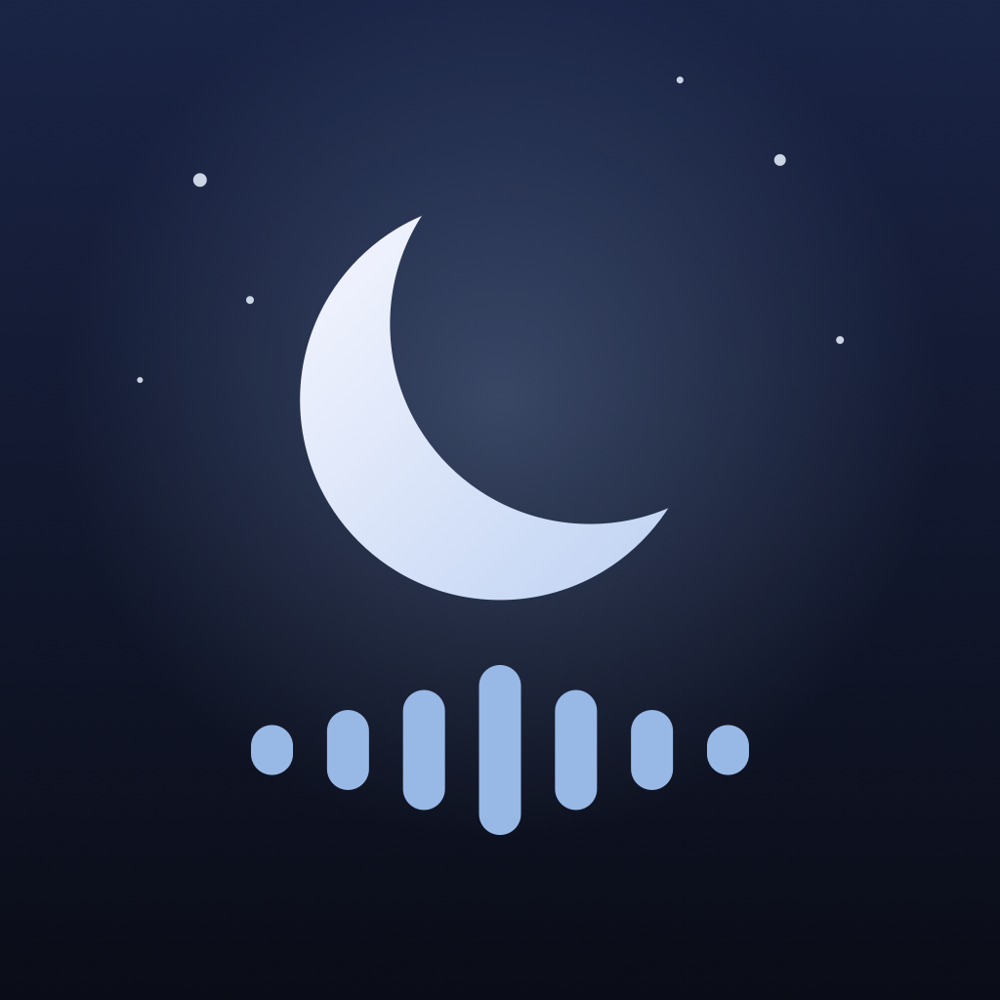

# Sleep Sounds

An iPhone app for falling asleep to nature sounds. Most of the sounds come from short videos I recorded myself; the rest are generated in code. Everything is bundled in the app, so it works fully offline.



## Features

- 16 sounds, each a 10-minute track that loops with no audible seam
- All sounds levelled to the same loudness, so switching doesn't jump in volume
- Keeps playing in the background and with the screen locked
- Sleep timer (2, 4, 6, 8 or 10 hours) that fades out over the last 30 seconds
- Shows how long the current sound has been playing
- Pauses when headphones are unplugged and resumes after calls or other interruptions

## Sounds

| Sound | What it is |
|---|---|
| Amicalola | Waterfall (recording) |
| Annapurna | Mountain waterfall (recording) |
| Big Sur | Pink noise (generated) |
| Colorado | Deep, rumbling waterfall (recording) |
| Inari | Nordic forest: rustling leaves, songbirds, a distant cuckoo (generated) |
| Kerala | Rain (recording) |
| Niagara | Brown noise (generated) |
| Ozark | Deep, rumbling waterfall (recording) |
| Patagonia | Roaring waterfall (recording) |
| Rainier | Waterfall (recording) |
| Sedona | Flowing water (recording) |
| Sentosa | Ocean waves on a beach (recording) |
| Serengeti | Savanna night: grass in the wind, crickets, distant frogs (generated) |
| Squamish | Bright, hissy waterfall (recording) |
| Tasmania | Steady rain with distant thunder (generated) |
| Yellowstone | Windy day near a waterfall (recording) |

## Requirements

- Xcode 16 or later
- iOS 17 or later

## Building

Open `WhiteNoise.xcodeproj` in Xcode, choose an iPhone or simulator, and press Run. To install on your own phone, set your team under **Signing & Capabilities**.

## Adding a sound

Sound names are the file names, and the tiles are sorted alphabetically.

**From a video or audio recording**

1. Put a video in `SourceVideos/` (git-ignored) or an audio file (`.m4a`, `.mp3`, `.wav`, ...) in `SourceAudio/`, named after the sound, e.g. `SourceVideos/Big Sur.mp4`.
2. From the repo root, run:

   ```sh
   swift scripts/extract_audio.swift
   ```

   For videos, the audio track is first copied unchanged into `SourceAudio/`. Each recording is then looped seamlessly, levelled, and written to `WhiteNoise/Sounds/<name>.m4a`. Existing sounds are skipped; add `--force` to rebuild them.
3. To cut part of a recording, add an entry to `scripts/trims.json` (times in seconds):

   ```json
   { "Annapurna": { "start": 1.3, "end": 4.0 } }
   ```

**Generated sounds** are defined in `scripts/generate_sounds.swift`. Rebuild them with:

```sh
swift -O scripts/generate_sounds.swift --force
```

The output is the same every time (fixed random seeds).

**Icons**: every sound uses the waveform icon unless it's listed in `customSymbols` in `WhiteNoise/SoundLibrary.swift`, which maps a sound name to an [SF Symbol](https://developer.apple.com/sf-symbols/).

## App icon

The icon is drawn by `scripts/make_app_icon.swift`. After editing it, run `swift scripts/make_app_icon.swift` to update `AppIcon.png`.

## Project layout

```
WhiteNoise/
  WhiteNoiseApp.swift      App entry point, audio session setup
  ContentView.swift        Sound grid, sleep timer, now-playing bar
  AudioPlayer.swift        Gapless looping playback, timer, interruptions
  SoundLibrary.swift       Loads bundled sounds, picks icons
  Sounds/                  The 10-minute tracks bundled in the app
SourceAudio/               Original recordings, audio only
scripts/
  extract_audio.swift      Recordings -> looping tracks
  generate_sounds.swift    Synthesized tracks
  make_app_icon.swift      App icon
  trims.json               Per-sound trims
```
